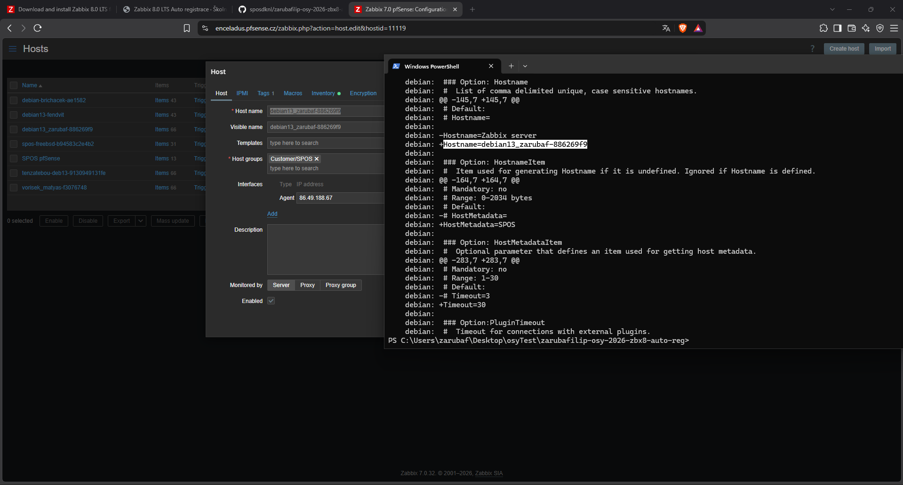

# OSY: Automatická registrace Debianu 13 do Zabbixu

Toto je šablona zadání pro výuku předmětu OSY na [osy.sposdk.cz](https://osy.sposdk.cz/). Z této šablony vznikne váš vlastní žákovský repozitář. Pracujte a odevzdávejte změny v něm.


## 1. Popis projektu

Tento projekt vznikl v rámci předmětu Operační systémy (OSY). Jeho cílem je automatizovat nasazení virtuálního serveru s operačním systémem Debian 13 a jeho připojení do monitorovacího systému Zabbix 8.0 LTS.

Pro vytvoření a konfiguraci virtuálního stroje je využit nástroj **Vagrant**. Instalace a nastavení Zabbix Agent 2 probíhá automaticky prostřednictvím provisioning skriptů, bez nutnosti ručních zásahů uvnitř virtuálního stroje.

## 2. Použité technologie

- **Debian 13** – operační systém virtuálního stroje.
- **Vagrant** – automatizované vytváření a správa virtuálního stroje.
- **VirtualBox** – virtualizační platforma.
- **Zabbix Agent 2 8.0 LTS** – monitorovací agent.
- **Bash** – instalační a konfigurační skripty.
- **Git a GitHub** – správa verzí a odevzdání projektu.

## 3. Princip fungování

Celé nasazení je automatizováno pomocí souboru `Vagrantfile` a provisioning skriptů.

Postup nasazení:

1. Vagrant vytvoří virtuální stroj s Debianem 13.
2. Spustí se provisioning skripty.
3. Přidá se oficiální repozitář Zabbix 8.0 LTS pro Debian 13.
4. Nainstaluje se Zabbix Agent 2.
5. Automaticky se nastaví konfigurace agenta.
6. Spustí a povolí se služba Zabbix Agent 2.
7. Agent naváže aktivní spojení se Zabbix serverem a zahájí automatickou registraci.

### Konfigurace Zabbix agenta

Agent komunikuje se serverem:

`enceladus.pfsense.cz`

## 4. Spuštění projektu

### Požadavky

Před spuštěním je potřeba mít nainstalováno:

- Oracle VM VirtualBox
- HashiCorp Vagrant
- Git (volitelně pro správu verzí)

### Spuštění virtuálního stroje

V kořenovém adresáři projektu spusťte PowerShell nebo terminál a zadejte:

```bash
vagrant up
```

Tím se vytvoří virtuální stroj, nainstaluje Debian 13 a automaticky se provedou všechny konfigurační a instalační kroky.

## 5. Ověření funkčnosti

Po dokončení provisioningu je možné ověřit instalaci a stav Zabbix Agenta 2 přímo ve virtuálním stroji.

Kontrola verze agenta:

```bash
zabbix_agent2 -V
```

Dále je potřeba ověřit na Zabbix serveru `enceladus.pfsense.cz`, že:

- Host byl úspěšně automaticky zaregistrován.
- Host má správný jedinečný název.
- Host je přiřazen do odpovídající skupiny.
- Host má správný štítek a šablonu pro Linux monitoring pomocí Zabbix Agent 2.
- Z hosta přicházejí monitorovací data.

## 6. Závěr

Cílem projektu je vytvoření automatizovaného řešení pro nasazení Debianu 13 s monitorovacím agentem Zabbix Agent 2 ve verzi 8.0 LTS.

Díky využití Vagrantu a provisioning skriptů je možné celý proces opakovaně spustit bez nutnosti manuální instalace a konfigurace uvnitř virtuálního stroje.



